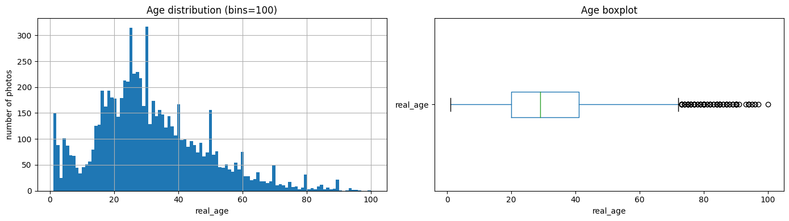
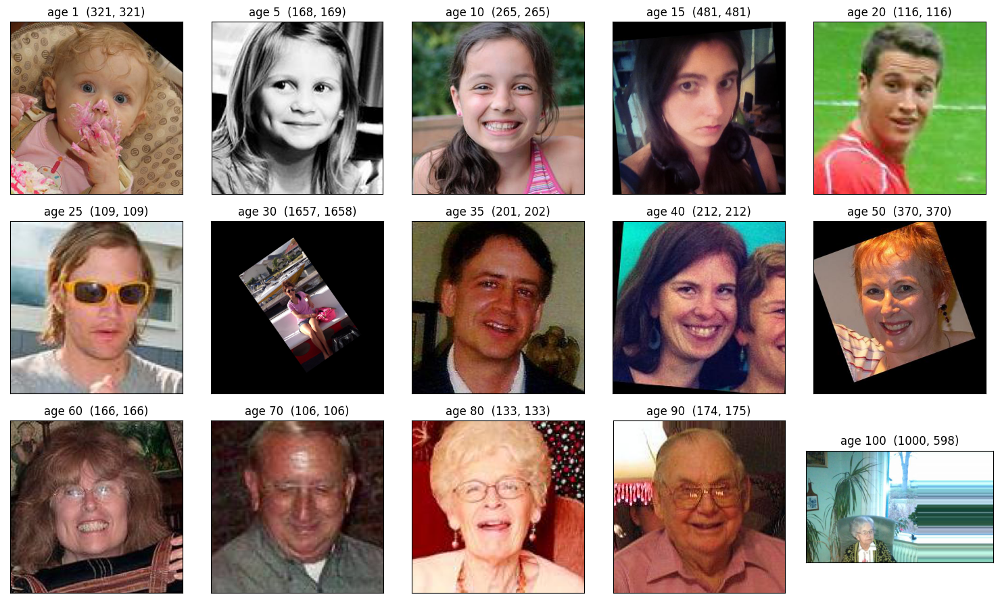

# Age Estimation from Face Photos

A ResNet50 regression model that predicts a person's age from a photograph, built to evaluate whether computer vision can help a supermarket chain stop selling alcohol to people underage.

**Best validation MAE 6.64 years** across 7,591 labelled faces. The headline number clears the brief, and the write up explains why it still should not be the thing that makes the legal decision.

## The problem

Good Seed runs checkout cameras that fire when someone buys alcohol. The question put to me was whether a model can read age off that photo well enough to enforce the law. The dataset is 7,591 faces from ChaLearn Looking at People, each labelled with a real age.

## Run it

```bash
pip install -r requirements.txt

python explore_faces.py     # EDA, writes figures and results/eda_summary.json
python train_age_model.py   # trains ResNet50, saves models/age_resnet50.keras
```

Both scripts read the dataset from `/datasets/faces/`. Point `FACES_PATH` somewhere else if your copy lives elsewhere:

```bash
FACES_PATH=~/data/faces/ python explore_faces.py
```

`explore_faces.py` runs in under a minute on CPU. **`train_age_model.py` needs a GPU.** 7,591 images through ResNet50 for 20 epochs took about 35 seconds per epoch on GPU and is not worth starting on CPU.

## Results

| Metric | Value |
| --- | --- |
| Best validation MAE | 6.64 years (epoch 17) |
| Final epoch validation MAE | 7.65 years |
| Final epoch training MAE | 3.18 years |
| Epochs | 20 |
| Backbone | ResNet50, ImageNet weights |

Full epoch by epoch output is in `results/training_log.txt` and the summary in `results/results.json`.

Training MAE falls from 7.43 to 3.18 while validation MAE only improves from 8.49 to the 6.6 to 7.6 range and flattens from about epoch 8. That gap is overfitting: the backbone memorizes the training faces faster than it learns anything that generalizes.

Validation is also noisy. Epoch 12 spikes to 11.46 and recovers immediately, which is what a validation split of roughly 1,898 images with thin coverage at the age extremes looks like.

The run has no early stopping, so the delivered weights are epoch 20 rather than the better epoch 17. That is the first thing I would change.

## Can it actually be used

Partly. It is useful, and it cannot be the thing that makes the legal decision.

An average error of 6.6 years is far too coarse for a hard boundary at 21. A 19 year old can read as 25 and a 23 year old can read as 17. A false negative is a fine and a risk to the store licence.

The error is not evenly distributed either. Over 60s are 6.9% of the dataset and over 80s are 1.5%, so a single global MAE flatters the model and hides much larger errors at the extremes. The band that actually matters for alcohol sales, roughly 16 to 25, is well covered, which is the one thing working in this project's favour.

**The deployment that works is triage, not an automatic gate.** Predicted age comfortably above the threshold, say 30 or more, let the sale through. Anywhere near the boundary, prompt the cashier for ID. That turns the model into a workload reducer with a human on every borderline case, and it fails safe: the cost of a wrong prediction is one extra ID check, not an illegal sale.

## The data

| | |
| --- | --- |
| Photos | 7,591, one label each, no missing values, no duplicate filenames |
| Age range | 1 to 100 |
| Mean / median | 31.2 / 29 |
| Quartiles | 20 and 41 |



| Age bucket | Share |
| --- | --- |
| 0 to 10 | 8.7% |
| 10 to 20 | 16.0% |
| 20 to 30 | 27.3% |
| 30 to 40 | 20.6% |
| 40 to 50 | 12.4% |
| 50 to 60 | 8.1% |
| 60 to 70 | 3.7% |
| 70 to 80 | 1.7% |
| 80 to 100 | 1.5% |

Ages 10 to 40 are 63.9% of the data. Everyone above 60 is 6.9%.

The histogram spikes at round ages like 25, 30, 45 and 50, which means the labels were partly estimated rather than measured. That puts a floor under the achievable MAE: no model beats the error already sitting in its own ground truth.

Image quality is inconsistent. Every photo is RGB, but in a random sample of 500 the smallest side is 57 pixels and the largest is 3,008, and the most common size appears 4 times out of 500. Some shots are tight crops, some are black and white, some are rotated, and some are wide frames where the face is a small part of the picture.



## The model

```python
backbone = ResNet50(input_shape=(224, 224, 3), weights='imagenet', include_top=False)

model = Sequential()
model.add(backbone)
model.add(GlobalAveragePooling2D())
model.add(Dense(1, activation='relu'))

model.compile(optimizer=Adam(learning_rate=0.0005), loss='mse', metrics=['mae'])
```

Regression, not classification, so one output neuron with a relu activation, MSE as the loss and MAE as the reported metric. `GlobalAveragePooling2D` instead of `Flatten` keeps the classifier head at 2,048 inputs rather than 100,352.

7,591 images is small for training a deep network from scratch, so the whole thing rests on transfer learning from ImageNet.

## Data loading

Labels live in one CSV rather than in class folders, so the loader is `flow_from_dataframe`, not `flow_from_directory`.

```python
train_datagen = ImageDataGenerator(rescale=1/255., horizontal_flip=True, validation_split=0.25)
```

Resizing to 224x224 is mandatory because the network needs one fixed input shape and the source images vary wildly. Non square photos get squashed by that resize, which distorts face proportions. At this dataset size that is a cost worth accepting rather than building a face detection and cropping stage first.

Augmentation is horizontal flip only. A mirrored face is still a plausible photo. Vertical flips and large rotations produce images that never occur at a supermarket checkout.

The validation generator gets `rescale` and `validation_split` and nothing else, and both flows use the same seed so the 75/25 split does not leak.

## Files

| File | What it does |
| --- | --- |
| `explore_faces.py` | EDA: dataset size, age distribution, image property audit, both figures |
| `train_age_model.py` | Loads the data, builds ResNet50, trains 20 epochs, saves the model |
| `results/results.json` | Run configuration and headline metrics |
| `results/training_log.txt` | Full 20 epoch output |
| `figures/` | Age distribution and the sample face grid |

## What I would do next

1. Add `EarlyStopping` with `restore_best_weights=True` so the delivered model is epoch 17 and not whatever epoch 20 produced.
2. Report MAE per age band instead of one global number, since the global figure hides the model's worst segment.
3. Collect more photos in the 16 to 30 band, which is the only range the business decision actually turns on.
4. Run face detection and crop before the model so the input stops varying between tight portraits and wide group shots.
5. Optimize against the threshold decision rather than plain MAE, because the business cares about one boundary and not about being accurate at 80.

## Other uses for the same model

Tobacco, lottery tickets and other age restricted products run through the same camera trigger and the same triage rule. Anonymous age mix per store and per hour would inform assortment and staffing, and that use needs far less precision than the legal check, so the current model is already good enough for it.

Any of this needs a privacy review first. The cameras capture biometric data, so retention limits, signage and consent, and keeping inference on device rather than shipping faces to a server are design constraints, not afterthoughts.

## Data

Faces from ChaLearn Looking at People. Prepared and provided through the TripleTen AI/ML program; the dataset itself is not redistributed here.
